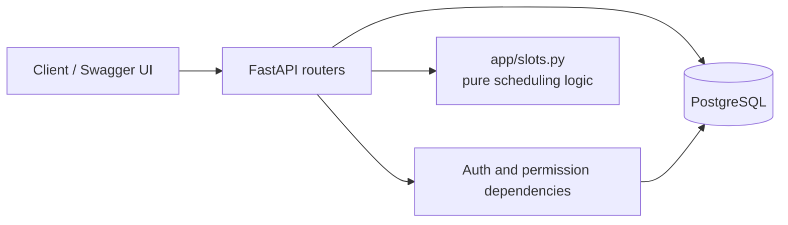
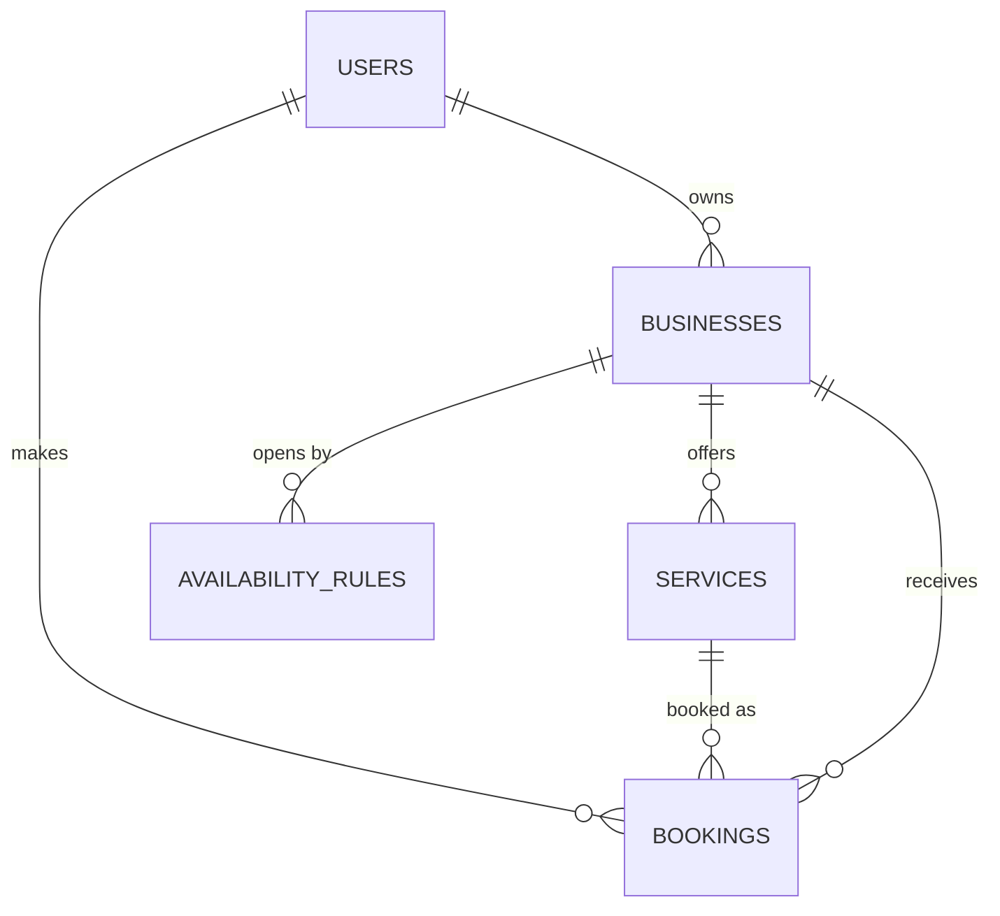
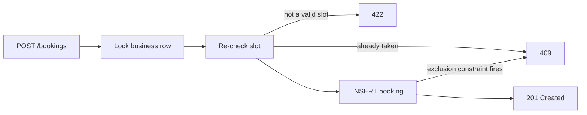

# Bookable

[](https://github.com/michael-shippey/bookable/actions/workflows/ci.yml)

A booking and reservation REST API. Businesses publish their weekly hours, customers anywhere in the world book time slots in their own timezone, and the database guarantees nobody is ever double-booked.

Built with **Python, FastAPI, PostgreSQL, SQLAlchemy 2, and Alembic**, and tested against a real Postgres database in CI.

## What it does

- **Accounts and roles.** Registration, JWT login, and three roles (customer, business owner, admin). Role checks say what you may do; ownership checks say to which business.
- **Businesses and services.** Owners manage their businesses and the services they sell. Prices are stored as integer cents, and services are deactivated rather than deleted so booking history survives.
- **Weekly availability.** Opening hours in the business's local time, including overnight windows (Friday 20:00 to Saturday 02:00) and all-day windows for 24-hour businesses. Overlapping windows are rejected, even across midnight and across the Sunday-to-Monday wrap.
- **Timezone-correct slots.** A customer asks for a day *in their own timezone* and gets bookable slots as exact moments, shown on the business's clock and their own. A customer in Tokyo and a business in Boise see the same instants.
- **Bookings with no double-booking.** Enforced in three layers (see below), including a Postgres exclusion constraint.
- **Cancellation policy.** Customers cancel up to a configurable notice period (24 hours by default). Owners and admins can cancel any time before the start.

## Architecture





## Key design decisions

### 1. Two kinds of time

Opening hours are **wall-clock times in the business's timezone** ("9:00 to 17:00, every Monday"). A booking is an **exact instant**, stored in UTC. Slot generation is the translation between the two: it converts the customer's local day into a UTC range, converts the business's windows into UTC, and compares. Doing the conversion to exact instants first means daylight saving, half-hour timezones, and overnight windows need no special cases. The tests cover a 25-hour fall-back day, a 23-hour spring-forward day, an overnight window that is 7 real hours on one night and 6 on another, and a business in India.

Booking requests must carry a UTC offset. A bare local time like `2026-11-01 01:30` can happen twice on a fall-back night, so it is rejected as ambiguous.

### 2. Preventing double bookings, in three layers

1. **Re-validation.** `POST /bookings` regenerates the slots using the same function as the availability endpoint and checks the requested start is one of them, so the two endpoints can never disagree.
2. **A row lock.** The business row is locked (`SELECT ... FOR UPDATE`) during the check and insert, so simultaneous requests for one business take turns and losers get a clean `409`.
3. **An exclusion constraint.** Postgres itself refuses overlapping confirmed bookings:

   ```sql
   EXCLUDE USING gist (
       business_id WITH =,
       tstzrange(start_at, end_at, '[)') WITH &&
   ) WHERE (status = 'confirmed')
   ```

   Half-open ranges let back-to-back bookings coexist, and the `WHERE` clause means cancelling frees the slot. Layers 1 and 2 give friendly errors; layer 3 is the guarantee that holds even if the application code has a bug.



### 3. Keeping denormalized data honest

Bookings store `business_id` as well as `service_id` (the constraint above needs it). A composite foreign key on `(service_id, business_id)` guarantees the pair always matches a real service of that business, so a booking can never mix one business's calendar with another's service.

### 4. History is protected

Bookings reference their business, service, and customer with `ON DELETE RESTRICT`. A business with bookings cannot be deleted, and services are soft-deleted via `is_active`.

### 5. Security details

- Passwords hashed with Argon2; the API never returns a hash.
- Registration cannot choose a role, so nobody can register as an admin.
- Login returns the same vague error for a wrong password and an unknown email, and does the same amount of hashing work for both, so neither the message nor the response time reveals which emails exist.
- Strangers asking about someone else's booking get `404`, not `403`, so they cannot learn which ids exist.
- The app refuses to start without a `SECRET_KEY`.

### 6. A pure core

The scheduling logic in `app/slots.py` and `app/availability.py` has no database or web-framework dependency, which makes it easy to test exhaustively.

## Testing

**135 tests**, run on every push by GitHub Actions against a real PostgreSQL service.

- **Pure logic tests** for slot generation, overlap detection, and validation, including the daylight-saving edge cases.
- **API tests against a real database.** At the start of each run a separate `*_test` database is wiped and rebuilt by running every Alembic migration, so the migrations are tested too. Each test starts with empty tables.
- **Concurrency tests.** Eight simultaneous requests for one slot must produce exactly one success; two simultaneous requests for overlapping slots must produce exactly one success.
- **Constraint tests that bypass the app.** Rows are inserted directly to prove Postgres refuses overlapping bookings on its own.

## API overview

| Area | Endpoints |
|---|---|
| Auth | `POST /auth/login` |
| Users | `POST /users`, `GET /users/me`, `PATCH /users/me` |
| Businesses | `POST/GET /businesses`, `GET/PATCH/DELETE /businesses/{id}` |
| Services | `POST/GET /businesses/{id}/services`, `GET/PATCH /services/{id}` |
| Opening hours | `POST/GET /businesses/{id}/availability/rules`, `DELETE .../rules/{rule_id}` |
| Slots | `GET /services/{id}/availability?date=YYYY-MM-DD&timezone=Asia/Tokyo` |
| Bookings | `POST /bookings`, `GET /bookings/me`, `GET /bookings/{id}`, `POST /bookings/{id}/cancel`, `GET /businesses/{id}/bookings` |
| Health | `GET /health`, `GET /health/db` |

Interactive docs are served at `/docs`.

## Run it locally

Requires Docker.

```bash
docker compose up --build
docker compose run --rm api alembic upgrade head
```

- API docs: http://localhost:8000/docs
- Run the tests: `docker compose run --rm api pytest`

## Project layout

```
app/
  main.py           app and router wiring
  config.py         settings from environment variables
  database.py       engine and session
  security.py       password hashing and JWTs
  dependencies.py   current-user and role dependencies
  permissions.py    ownership checks and business lookup
  slots.py          slot generation (pure)
  availability.py   weekly-window math (pure)
  bookings.py       busy-interval query
  models/           SQLAlchemy models
  schemas/          Pydantic request/response models
  routers/          HTTP endpoints
alembic/versions/   migrations (one is hand-written for the exclusion constraint)
tests/              pure tests, real-database API tests, concurrency tests
```

## Limitations and what I would change at scale

- **One calendar per business.** A business is a single bookable resource, so a salon with three stylists would need a staff or capacity concept, and the exclusion constraint would key on staff instead of business.
- **Slots are calculated on every request.** That avoids stale stored slots, but a busy business would want the result cached (for example in Redis) and invalidated when hours or bookings change.
- **Availability is advisory.** A slot can be taken between listing and booking; the booking step is what guarantees correctness.
- **Opening-hour changes are not versioned.** Existing bookings keep their exact instants, which is correct, but there is no record of what the hours used to be.
- **Time-zone rule changes.** If a government changes daylight-saving rules, an already-booked instant keeps its UTC value and its local rendering shifts. The business timezone is stored, so affected bookings can be found and reviewed.
- **JWTs cannot be revoked** before they expire, and there are no refresh tokens.
- **Offset pagination** is simple but slows down on very large tables; keyset pagination would be the next step.
- **Slots start at each window's opening time** and step forward from there, rather than sharing one fixed grid across all businesses.

## Roadmap

Planned but not built yet: holiday and special-hours exceptions, confirmation and reminder emails through a background worker, rate limiting and structured logging, an admin reporting endpoint, a "request outside published hours" flow where the owner approves, and a deployed demo.
